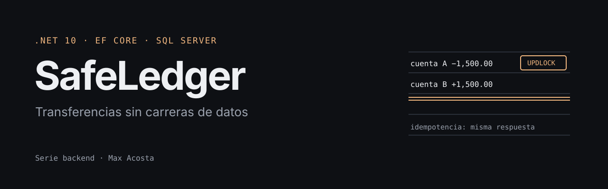

# SafeLedger API (.NET 10 FinTech Core)

<p align="center"></p>

## Descripción

SafeLedger es una API transaccional de alto rendimiento diseñada con arquitectura limpia (Clean Architecture) para garantizar la integridad financiera y la seguridad en operaciones de transferencia entre cuentas. Construida con .NET 10 y C#, implementa patrones avanzados de concurrencia pesimista, idempotencia y detección de fraude.

## Arquitectura

La solución sigue los principios de **Clean Architecture**, separando las responsabilidades en capas independientes:

```
┌─────────────────────────────────────────────────────────────┐
│                      SafeLedger.API                         │
│  (Controllers, Middlewares, HTTP Pipeline)                  │
└───────────────────────┬─────────────────────────────────────┘
                        │
┌───────────────────────▼─────────────────────────────────────┐
│                 SafeLedger.Application                       │
│  (Services, DTOs, Validators, Interfaces)                   │
└───────────────────────┬─────────────────────────────────────┘
                        │
┌───────────────────────▼─────────────────────────────────────┐
│                   SafeLedger.Domain                         │
│  (Entities, Domain Logic, Repository Interfaces)            │
└───────────────────────┬─────────────────────────────────────┘
                        │
┌───────────────────────▼─────────────────────────────────────┐
│              SafeLedger.Infrastructure                       │
│  (EF Core, Repositories, DbContext, Adapters)               │
└─────────────────────────────────────────────────────────────┘
```

### Capas

- **Domain**: Contiene las entidades de negocio (`Account`, `TransactionRecord`) y la lógica de dominio. No tiene dependencias externas.
- **Application**: Implementa los casos de uso, servicios de aplicación, DTOs y validaciones. Depende solo de Domain.
- **Infrastructure**: Implementa la persistencia con Entity Framework Core, repositorios y adaptadores. Depende de Domain y Application.
- **API**: Capa de presentación con controladores, middlewares y configuración del pipeline HTTP. Depende de Application e Infrastructure.

## Características clave

### Concurrencia Pesimista (SQL RowLock/UpdLock)

Implementación de bloqueos a nivel de fila usando hints SQL `UPDLOCK` y `ROWLOCK` para prevenir condiciones de carrera en operaciones financieras concurrentes:

```csharp
// Bloquea la fila específica durante la lectura para actualización
SELECT * FROM Accounts WITH (UPDLOCK, ROWLOCK) WHERE Id = @id
```

Esto garantiza que solo una transacción puede modificar una cuenta a la vez, eliminando el riesgo de pérdida de actualización (lost update) en escenarios de alta concurrencia.

### Patrón de Idempotencia con Caché

Middleware que implementa idempotencia mediante el header `Idempotency-Key`, permitiendo reintentos seguros sin duplicar transacciones:

- Las respuestas exitosas se almacenan en caché distribuida por 1 hora
- Reintentos con la misma clave devuelven la respuesta cacheada sin ejecutar la operación nuevamente
- Previene duplicación de transacciones en caso de timeouts o errores de red

### Validaciones de Dominio y Detección de Fraude

- **Validaciones de entrada**: FluentValidation para DTOs con reglas de negocio (montos positivos, precisión decimal, cuentas diferentes)
- **Detección de fraude**: Servicio que analiza patrones sospechosos (montos elevados, horarios, etc.)
- **Lógica de dominio encapsulada**: Los métodos `Credit()` y `Debit()` de `Account` garantizan invariantes de negocio

### Transacciones ACID

Todas las operaciones de transferencia se ejecutan dentro de transacciones de base de datos con garantías ACID:

- **Atomicity**: Todas las operaciones se completan o ninguna
- **Consistency**: Los saldos siempre reflejan el estado correcto
- **Isolation**: Las transacciones concurrentes no interfieren entre sí
- **Durability**: Los cambios se persisten de forma permanente

## Cómo correrlo en local

### Prerrequisitos

- .NET 10 SDK
- SQL Server (LocalDB incluido con Visual Studio) o SQL Server Express
- Visual Studio 2022 o Visual Studio Code

### Instalación

1. **Clonar el repositorio**
   ```bash
   git clone <https://github.com/MaxAcosta-30/SafeLedger-API>
   cd SafeLedger
   ```

2. **Configurar la cadena de conexión**

   Edita `src/SafeLedger.API/appsettings.json` y ajusta la cadena de conexión según tu entorno:

   ```json
   {
     "ConnectionStrings": {
       "DefaultConnection": "Server=(localdb)\\mssqllocaldb;Database=SafeLedgerDb;Trusted_Connection=True;MultipleActiveResultSets=true"
     }
   }
   ```

3. **Aplicar migraciones de Entity Framework**

   Desde la raíz del proyecto, ejecuta:

   ```bash
   cd src/SafeLedger.API
   dotnet ef database update --project ../SafeLedger.Infrastructure
   ```

   O si prefieres usar el Package Manager Console en Visual Studio:

   ```powershell
   Update-Database -Project SafeLedger.Infrastructure -StartupProject SafeLedger.API
   ```

4. **Ejecutar la aplicación**

   ```bash
   cd src/SafeLedger.API
   dotnet run
   ```

   La API estará disponible en `https://localhost:5001` o `http://localhost:5000` (consulta `launchSettings.json` para los puertos exactos).

5. **Acceder a Swagger UI**

   Navega a `https://localhost:5001/swagger` para explorar y probar los endpoints.

### Datos de Prueba

La aplicación inicializa automáticamente dos cuentas de prueba:

- **Cuenta Origen**: `11111111-1111-1111-1111-111111111111` (Saldo: $10,000 USD)
- **Cuenta Destino**: `22222222-2222-2222-2222-222222222222` (Saldo: $0 USD)

## Uso de la API

### Ejecutar una Transferencia

**Endpoint**: `POST /api/transfers`

**Headers**:
```
Content-Type: application/json
Idempotency-Key: <guid-unico-para-reintentos-seguros>
```

**Body**:
```json
{
  "senderId": "11111111-1111-1111-1111-111111111111",
  "receiverId": "22222222-2222-2222-2222-222222222222",
  "amount": 1000.50,
  "reference": "Pago de servicios"
}
```

**Respuesta Exitosa (200 OK)**:
```json
{
  "transactionId": "550e8400-e29b-41d4-a716-446655440000",
  "processedAtUtc": "2024-12-19T10:30:00Z"
}
```

### Idempotencia

Para garantizar idempotencia, incluye el header `Idempotency-Key` con un valor único (por ejemplo, un GUID). Si el mismo request se envía múltiples veces con la misma clave, solo se procesará una vez y las respuestas subsecuentes devolverán el resultado cacheado.

## Tecnologías Utilizadas

- **.NET 10**: Framework principal
- **Entity Framework Core**: ORM para persistencia
- **FluentValidation**: Validación de entrada
- **SQL Server**: Base de datos relacional
- **Swagger/OpenAPI**: Documentación de API
- **Distributed Cache**: Para idempotencia (MemoryCache por defecto)

## Estructura del Proyecto

```
SafeLedger/
├── src/
│   ├── SafeLedger.API/              # Capa de presentación
│   │   ├── Controllers/             # Controladores REST
│   │   ├── Middlewares/             # Middlewares HTTP
│   │   └── Program.cs               # Configuración de la aplicación
│   ├── SafeLedger.Application/      # Capa de aplicación
│   │   ├── DTOs/                    # Data Transfer Objects
│   │   ├── Interfaces/              # Contratos de servicios
│   │   ├── Services/                # Implementación de servicios
│   │   └── Validators/              # Validadores FluentValidation
│   ├── SafeLedger.Domain/           # Capa de dominio
│   │   ├── Entities/                # Entidades de negocio
│   │   └── Interfaces/              # Interfaces de repositorios
│   └── SafeLedger.Infrastructure/   # Capa de infraestructura
│       ├── Persistence/              # DbContext y configuraciones EF
│       ├── Repositories/             # Implementación de repositorios
│       └── Adapters/                 # Adaptadores para abstracciones
└── tests/
    └── SafeLedger.UnitTests/         # Pruebas unitarias
```

## Principios de Diseño

- **Dependency Inversion**: Las capas superiores dependen de abstracciones, no de implementaciones concretas
- **Single Responsibility**: Cada clase tiene una única responsabilidad bien definida
- **Encapsulation**: La lógica de negocio está encapsulada en las entidades de dominio
- **Separation of Concerns**: Cada capa tiene responsabilidades claramente separadas

## Seguridad

- Validación exhaustiva de entrada en múltiples capas
- Detección de fraude con análisis de patrones sospechosos
- Bloqueos pesimistas para prevenir condiciones de carrera
- Idempotencia para prevenir duplicación de transacciones
- Manejo seguro de excepciones sin exponer detalles internos

## Contribución

Este proyecto sigue estándares estrictos de Clean Code y Modern C#:

- File-scoped namespaces
- XML documentation en todas las APIs públicas
- Validación de entrada con FluentValidation
- Manejo explícito de excepciones de dominio
- Código sin comentarios triviales, solo documentación técnica esencial

## Licencia

Este proyecto está licenciado bajo la Licencia MIT. Consulta el archivo [LICENSE](LICENSE) para más detalles.

El uso de este código es libre para fines educativos y profesionales.

